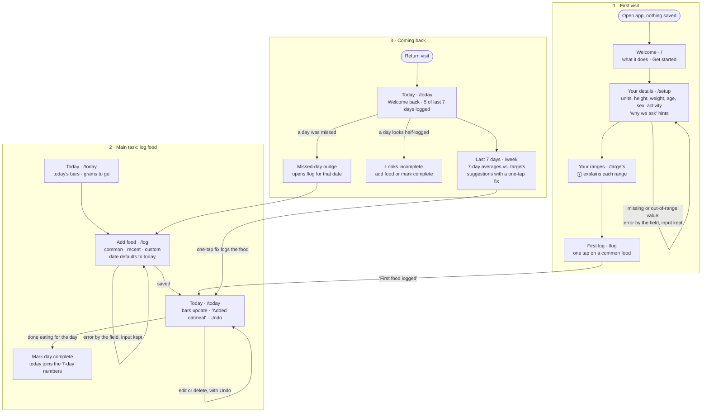

# Health Tracker (working name)

A diet tracker for keeping a **balanced diet** and maintaining your weight, not losing it. Enter a few details about yourself once, and it sets target ranges for calories, macros, fiber, added sugar, sodium and key vitamins and minerals. Log what you eat, and see where you stand today and over your last 7 days, with suggestions for what to eat more or less of.

Built for MPCS 51238 *Design, Build, Ship*, Assignment 3: Patterns & Flows.

## The main task, in one sentence

> I log what I ate today → I see where each nutrient stands today and over my last 7 days → I come back tomorrow, and it tells me what to eat more or less of.

## User flows

Three flows: the first visit, the main task, and coming back. Each step is its own page. Routes, states, errors and the full table of targets are in [`flows.md`](flows.md).



## How it works

- **No account.** Everything is saved in your browser (`localStorage`), so it remembers you on the device you used.
- **Targets** are estimates for maintaining your weight (Mifflin-St Jeor plus standard dietary guidelines), not medical advice.
- **A rolling 7-day window.** Each nutrient is judged on its average over the last 7 complete days, not fixed Monday–Sunday weeks. One day out of range isn't a miss; today's bars are a guide. Today counts once you mark it complete (or at midnight), and unlogged days are left out, not counted as zero.
- **The first week unlocks in stages:** averages after your first complete day, suggestions after 3, a full window on day 7, and a weekend vs. weekday trend after about two weeks.
- **Logging** needs a food name, calories, protein, carbs and fat. The other nutrients are optional, and the built-in common foods fill them all in.

## Run it locally

```bash
npm install
npm run dev
```

Then open http://localhost:3000.

Stack: Next.js, Tailwind CSS and TypeScript, deployed on Vercel.

## Onboarding research

Three research agents studied how **MyFitnessPal**, **MyNetDiary** and **Noom** welcome someone new. Full notes and sources are in [`research/onboarding-research.md`](research/onboarding-research.md).

**What they do**
- **Value comes late.** All three put a long quiz (18 to 113 screens), and usually a signup and paywall, before anything useful. Noom takes 10–15 minutes and shows a paywall with a countdown before you see the app.
- **Weight loss is the default.** Maintenance is a side option.
- **Many nutrients get shown a few at a time.** MyNetDiary expands the full vitamin list on tap; MyFitnessPal has a weekly-average view.
- **People dislike** streaks that reset, celebrations they can't dismiss, paywalled basics, cluttered dashboards with tooltip tours, and good-vs-bad food colors.

**What we're borrowing**
- **First visit:** six fields on one screen, then straight to your ranges and a one-tap first log, in about a minute. A "why we ask" hint on sensitive fields (Noom). ⓘ info buttons that explain each range and how it was calculated. An inline "First food logged" message (MyFitnessPal).
- **Logging:** one-tap add with Undo, and your last serving size remembered (MyFitnessPal, MyNetDiary). Bars that show grams and what's left. "What it adds" tags instead of good/bad colors.
- **Coming back:** suggestions with a one-tap fix. Mark a day complete, so half-logged days don't skew the numbers (MyNetDiary). A weekend vs. weekday trend. Days logged instead of streaks. And our own idea: a **rolling 7-day balance** instead of fixed weeks.

**What we're avoiding:** long quizzes, signup or paywall walls, fake "building your plan" loaders, countdown timers, streaks that reset, and good/bad food labels.

## First-run check

_To do (step 8): an agent's usability feedback from using the deployed tool as a brand-new user, and what changed because of it._
