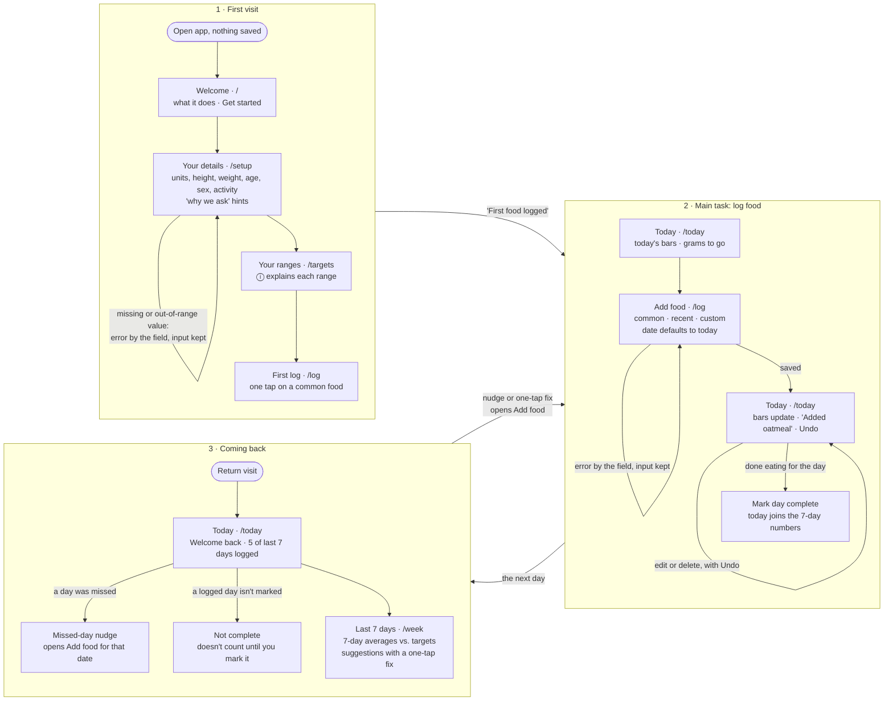

# User flows

The tool is built around three flows: the **first visit**, the **main task** (logging food), and **coming back** (your last 7 days and what to focus on). Each step is its own route. The diagram below is also in `README.md`; when you change one, change both.

## Main task, as one sentence

> I log what I ate today → I see where each nutrient stands today and over my last 7 days → I come back tomorrow, and it tells me what to eat more or less of.

## Diagram

## Routes

Shared navigation, shown once setup is done: **This week · History · Targets**, with the current page marked.

| Route | What it's for |
|---|---|
| `/` | Welcome card when nothing is saved; goes to the Food log once you're set up |
| `/setup` | Your details: units, height, weight, date of birth, sex (female, male, non-binary), activity level. Reused, prefilled, to edit them later |
| `/targets` | Your ranges, each with an ⓘ explanation of how it was calculated |
| `/log` | **This week.** Two tabs. **Progress:** week ribbons, one row per nutrient with a cell per day (in range / under / over / not logged) and the 7-day average that counts; the column headers are the day badges. Clicking a day (header or cell) opens that day in a **side panel** (status, Mark complete, foods under Breakfast / Lunch / Dinner / Snacks, collapsed to a food count and calories until tapped, each with a + Add, totals); clicking a nutrient expands its weekly detail (bar against target, each day, top food sources). **Foods:** a card per day with a kraft date tag and highlight tags (what the day did well, plus at most one heads-up), collapsed to its calories, status and Mark complete, with "See more" for its meals. **+ Add food** opens a **pop-up form** over a blurred page (a Meal choice, preset from the meal you clicked or the time of day; a Day dropdown that opens a month calendar limited to today and the 6 days before, search with Foods / Meals & recipes) |
| `/week` | Old address; forwards to `/log` |
| `/history` | Pick a day on an inline month calendar (defaults to today; the 7 days are highlighted) to see high-level stats for the 7 days ending on it: the 7 day badges, a **Calories by day** bar chart against the calorie range (with a table view), and a **Where your calories came from** split of protein, carbs and fat against their ranges. No food-by-food log |
| `/recipes` | Paste a recipe (reads its per-serving nutrition panel) or build one from ingredients; saved recipes are logged by the serving |
| `/today` | Old address; forwards to `/log` |

## How the 7-day window works

- **The 7-day average is what counts; daily ranges are a guide.** Each nutrient is judged on its average over today and the 6 days before. Going out of range on a single day is normal and isn't treated as a miss.
- **Only days you mark complete count.** A day is either complete (you tapped "Mark complete") or not complete; nothing is marked for you, past days included. The average divides by the number of complete days.
  - **Not complete** days (food logged, not marked) show faded and stay out of the averages until you mark them, so a half-logged day never drags the numbers down.
  - **Unlogged days** are gaps, not zeros.
- **Suggestions refresh daily.** They're calculated from complete days only, so they change at most once a day, never while you're logging.
- **Weekend vs. weekday trend** looks back 14 days, because 7 days only has 2 weekend days. It needs at least 3 complete weekend days and 5 complete weekdays, and only shows a difference of 20% or more.
- **Days logged** counts how many of the last 7 days have entries ("5 of last 7 days logged"). Unlike a streak, it can't reset to zero.

### The first week, in stages

| When | What appears |
|---|---|
| Day 1, before marking it complete | Today's bars. The 7-day card says "Your 7-day balance starts when you finish your first day" and offers "Mark day complete" |
| 1–2 complete days | 7-day averages, labeled "based on N days". "Suggestions start after 3 days" |
| 3+ complete days | Suggestions with a one-tap fix, refreshed daily |
| Day 7 | A full 7-day window and a "Your first week" message |
| Around day 8–14 | The weekend vs. weekday trend, once there's enough data |

## States and errors

- **Nothing logged yet today:** quick-add foods and a "Log your first meal" action, never a blank page.
- **First food logged:** an inline "First food logged" message on Today, no pop-up.
- **Missed day:** on return, "You didn't log Thursday. Add it?" opens `/log` with that date.
- **Not complete:** a logged day you haven't marked shows "Not complete" with a Mark complete button, and is left out of the averages until you mark it.
- **Details changed:** a new weight or activity level recalculates the ranges.
- **Sample data:** "Load a sample 2 weeks" on `/targets` asks you to confirm on the page, then fills the 15 days before today with example meals from the built-in foods, with portions scaled to your maintenance calories (weekends run salty; one weekday is half-logged, so it reads as incomplete). Days you already logged and today are left alone. Sample entries are marked (`lib/sample.ts`), so "Clear sample data" removes only them. This exists so the week views, trends and suggestions can be shown in class.
- **Can't save:** if the browser blocks storage (e.g. private browsing), a banner says your data won't be kept.
- **Setup errors:** next to the field and say what to do, e.g. "Enter a height between 4 ft and 7 ft 6 in". What you typed stays.
- **Log errors:** food name missing, calories missing, a negative number, or a date in the future. What you typed stays.
- **Delete:** an Undo message right after.

## What's tracked

The log form always shows food name, date, calories, protein, carbs and fat. The other seven nutrients are optional, under "More nutrients"; a blank means *unknown*, not zero, and averages say how many foods they're based on. Quick-add foods fill in all eleven, and carry "what it adds" tags (e.g. protein, fiber, vitamin C) instead of good/bad colors. On bars, going over a minimum is never shown in red.

Every nutrient is judged on its 7-day average; the same target is shown as a daily guide on Today.

| Nutrient | Kind | Target (adults, per day) |
|---|---|---|
| Calories | range | maintenance (National Academies 2023 energy equations) ±10% |
| Protein | range | 0.8–1.6 g per kg (higher minimum at 18 and 65+, 2.0 max if very active) |
| Carbs | range | 45–65% of calories, at least 130 g |
| Fat | range | 20–35% of calories (25–35% at 18) |
| Fiber | minimum | 14 g per 1,000 kcal |
| Sodium | limit | under 2,300 mg |
| Potassium | minimum | 3,400 mg (M) / 2,600 mg (F) |
| Calcium | minimum | 1,000 mg (1,200 for women 51+ and men 71+) |
| Iron | minimum | 8 mg (M, and F 51+) / 18 mg (F 19–50) |
| Vitamin A | minimum | 900 mcg RAE (M) / 700 mcg RAE (F) |
| Vitamin C | minimum | 90 mg (M) / 75 mg (F) |

Suggestions come from simple rules, with no API. They name real foods from the built-in list that are high in whatever fell short, with a button that logs one serving.
