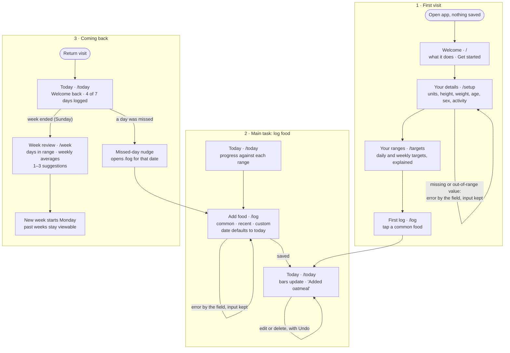

# User flows

The tool is built around three flows: the **first visit**, the **main task** (logging food), and **coming back** (the weekly review). Each step is its own route. The diagram below is also in `README.md`; when you change one, change both.

## Main task, as one sentence

> I log what I ate today → I see where each nutrient stands against my range → on Sunday I get my week in review and what to focus on next week.

## Diagram

## Routes

Shared navigation, shown once setup is done: **Today · Log · Week · Targets**, with the current page marked.

| Route | What it's for |
|---|---|
| `/` | Welcome when nothing is saved; goes to `/today` once you're set up |
| `/setup` | Your details: units, height, weight, age, sex, activity level. Reused, prefilled, to edit them later |
| `/targets` | Your ranges and what each one means; link to edit your details |
| `/today` | Today's progress against every range; the day's entries, with edit and delete; nudges |
| `/log` | Add food: common, recent or custom. The date defaults to today, so you can catch up on earlier days |
| `/week` | Week review (Mon–Sun): days in range per nutrient, weekly vitamin and mineral averages, 1–3 suggestions; earlier weeks |

## States and errors

- **Nothing logged yet today:** quick-add foods and a "Log your first meal" action, never a blank page.
- **Thin week:** fewer than 4 days logged still gets a review, labeled "based on N days".
- **Missed day:** on return, "You didn't log Thursday. Add it?" opens `/log` with that date.
- **Week rollover:** a new week starts Monday; earlier reviews stay viewable.
- **Details changed:** a new weight or activity level recalculates the ranges.
- **Can't save:** if the browser blocks storage (e.g. private browsing), a banner says your data won't be kept.
- **Setup errors:** next to the field and say what to do, e.g. "Enter a height between 4 ft and 7 ft 6 in". What you typed stays.
- **Log errors:** food name missing, calories missing, a negative number, or a date in the future. What you typed stays.
- **Delete:** an Undo message right after.

## What's tracked, and how it's judged

The log form always shows food name, date, calories, protein, carbs and fat. The other eight nutrients are optional, under "More nutrients"; a blank means *unknown*, not zero. Quick-add foods fill in all twelve. Vitamins and minerals vary a lot from day to day, so they're judged on the weekly average.

| Nutrient | Kind | Judged | Target (adults) |
|---|---|---|---|
| Calories | range | daily | maintenance (Mifflin-St Jeor × activity) ±10% |
| Protein | range | daily | 10–35% of calories, at least 0.8 g per kg |
| Carbs | range | daily | 45–65% of calories |
| Fat | range | daily | 20–35% of calories |
| Fiber | minimum | daily | 14 g per 1,000 kcal |
| Added sugar | limit | daily | under 10% of calories |
| Sodium | limit | daily | under 2,300 mg |
| Potassium | minimum | weekly average | 3,400 mg (M) / 2,600 mg (F) |
| Calcium | minimum | weekly average | 1,000 mg (1,200 for women 51+ and men 71+) |
| Iron | minimum | weekly average | 8 mg (M, and F 51+) / 18 mg (F 19–50) |
| Vitamin A | minimum | weekly average | 900 mcg RAE (M) / 700 mcg RAE (F) |
| Vitamin C | minimum | weekly average | 90 mg (M) / 75 mg (F) |

Weekly suggestions come from simple rules, with no API. They name real foods from the built-in list that are high in whatever fell short.
