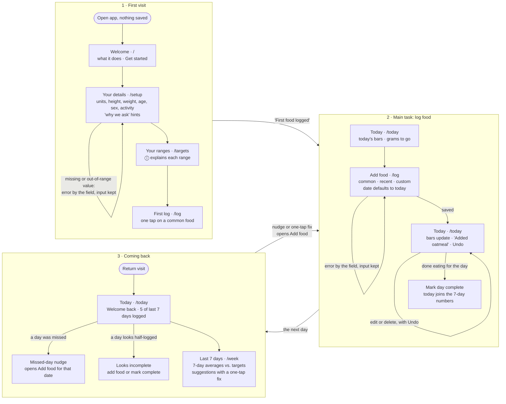

# User flows

The tool is built around three flows: the **first visit**, the **main task** (logging food), and **coming back** (your last 7 days and what to focus on). Each step is its own route. The diagram below is also in `README.md`; when you change one, change both.

## Main task, as one sentence

> I log what I ate today → I see where each nutrient stands today and over my last 7 days → I come back tomorrow, and it tells me what to eat more or less of.

## Diagram

## Routes

Shared navigation, shown once setup is done: **Today · Log · Last 7 days · Targets**, with the current page marked.

| Route | What it's for |
|---|---|
| `/` | Welcome when nothing is saved; goes to `/today` once you're set up |
| `/setup` | Your details: units, height, weight, age, sex, activity level, with a "why we ask" hint on sensitive fields. Reused, prefilled, to edit them later |
| `/targets` | Your ranges, each with an ⓘ button that explains the range and how it was calculated from your details. Links to edit your details and to load sample data |
| `/today` | Today's bars (grams and what's left), the day's entries with edit and delete, "Mark day complete", and nudges |
| `/log` | Add food: common, recent or custom. One tap adds a serving; the date defaults to today, so you can catch up on earlier days |
| `/week` | **Last 7 days:** each nutrient's 7-day average against its target, days in range, 1–3 suggestions with a one-tap fix, and the weekend vs. weekday trend once there's enough data |

## How the 7-day window works

- **The 7-day average is what counts; daily ranges are a guide.** Each nutrient is judged on its average over today and the 6 days before. Going out of range on a single day is normal and isn't treated as a miss.
- **Only complete days count.** A day counts toward the averages once it's complete. The average divides by the number of complete days, and the page says so: "based on 5 of the last 7 days".
  - **Past days** are complete automatically, unless they look half-logged (under 40% of your maintenance calories). Those are flagged "Looks incomplete", with "Add food" or "Mark complete".
  - **Today** counts once you tap "Mark day complete", or automatically once midnight passes. Until then Today shows "today so far" on its own, so a half-eaten morning doesn't drag the averages down.
  - **Unlogged days** are gaps, not zeros.
- **Suggestions refresh daily.** They're calculated from complete days only, so they change at most once a day, never while you're logging.
- **Weekend vs. weekday trend** looks back 14 days, because 7 days only has 2 weekend days. It needs at least 3 complete weekend days and 5 complete weekdays, and only shows a difference of 20% or more.
- **Days logged** counts how many of the last 7 days have entries ("5 of last 7 days logged"). Unlike a streak, it can't reset to zero.

### The first week, in stages

| When | What appears |
|---|---|
| Day 1, before marking it complete | Today's bars. The 7-day card says "Your 7-day balance starts when you finish your first day" and offers "Mark day complete" |
| 1–2 complete days | 7-day averages, labeled "based on N days". "Suggestions start after 3 days" |
| 3+ complete days | Suggestions with a one-tap fix, refreshed daily |
| Day 7 | A full 7-day window and a "Your first week" message |
| Around day 8–14 | The weekend vs. weekday trend, once there's enough data |

## States and errors

- **Nothing logged yet today:** quick-add foods and a "Log your first meal" action, never a blank page.
- **First food logged:** an inline "First food logged" message on Today, no pop-up.
- **Missed day:** on return, "You didn't log Thursday. Add it?" opens `/log` with that date.
- **Looks incomplete:** a past day under 40% of maintenance calories gets "Add food" or "Mark complete" and is left out of the averages until resolved.
- **Details changed:** a new weight or activity level recalculates the ranges.
- **Sample data:** "Load a sample 2 weeks" on `/targets` asks you to confirm on the page, then replaces your data with clearly labeled example logs. "Clear sample data" removes them. This exists so suggestions and trends can be shown in class.
- **Can't save:** if the browser blocks storage (e.g. private browsing), a banner says your data won't be kept.
- **Setup errors:** next to the field and say what to do, e.g. "Enter a height between 4 ft and 7 ft 6 in". What you typed stays.
- **Log errors:** food name missing, calories missing, a negative number, or a date in the future. What you typed stays.
- **Delete:** an Undo message right after.

## What's tracked

The log form always shows food name, date, calories, protein, carbs and fat. The other seven nutrients are optional, under "More nutrients"; a blank means *unknown*, not zero, and averages say how many foods they're based on. Quick-add foods fill in all eleven, and carry "what it adds" tags (e.g. protein, fiber, vitamin C) instead of good/bad colors. On bars, going over a minimum is never shown in red.

Every nutrient is judged on its 7-day average; the same target is shown as a daily guide on Today.

| Nutrient | Kind | Target (adults, per day) |
|---|---|---|
| Calories | range | maintenance (Mifflin-St Jeor × activity) ±10% |
| Protein | range | 10–35% of calories, at least 0.8 g per kg |
| Carbs | range | 45–65% of calories |
| Fat | range | 20–35% of calories |
| Fiber | minimum | 14 g per 1,000 kcal |
| Sodium | limit | under 2,300 mg |
| Potassium | minimum | 3,400 mg (M) / 2,600 mg (F) |
| Calcium | minimum | 1,000 mg (1,200 for women 51+ and men 71+) |
| Iron | minimum | 8 mg (M, and F 51+) / 18 mg (F 19–50) |
| Vitamin A | minimum | 900 mcg RAE (M) / 700 mcg RAE (F) |
| Vitamin C | minimum | 90 mg (M) / 75 mg (F) |

Suggestions come from simple rules, with no API. They name real foods from the built-in list that are high in whatever fell short, with a button that logs one serving.
